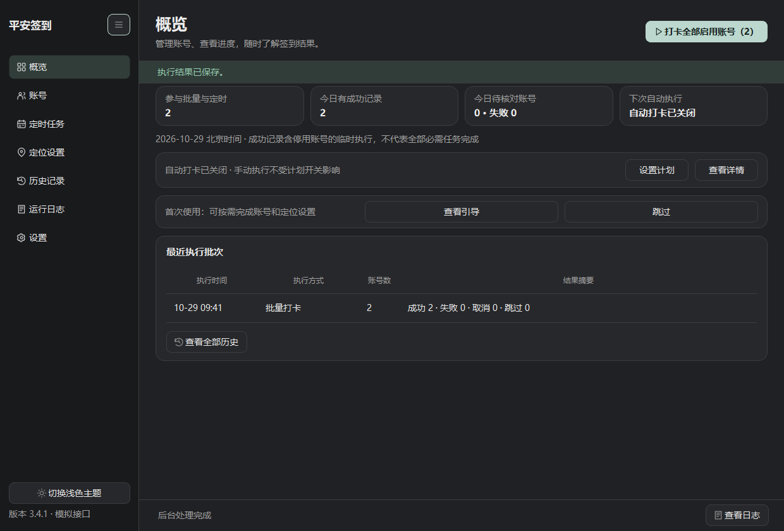
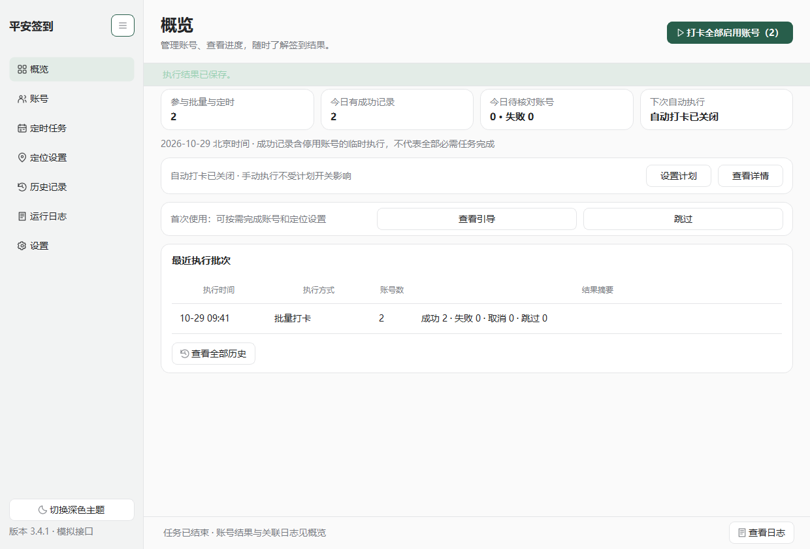
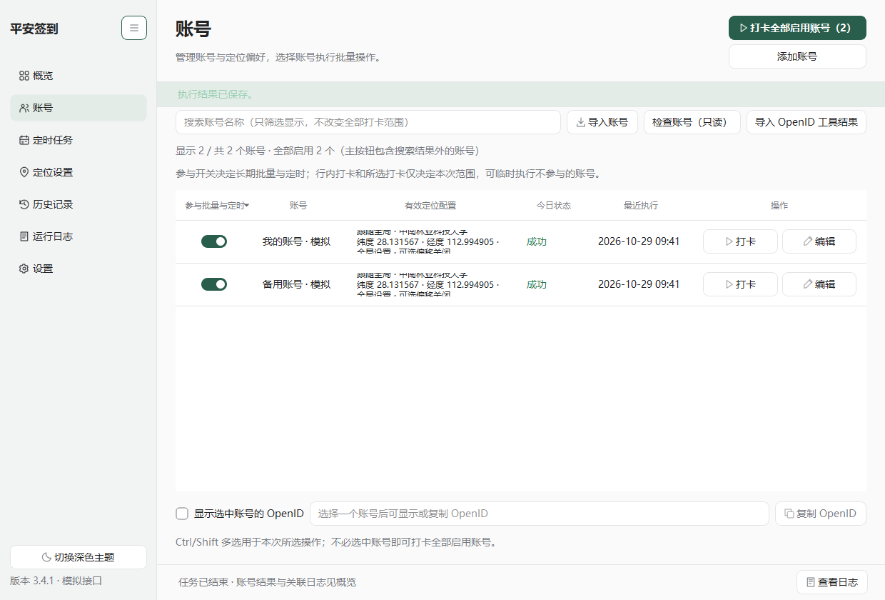
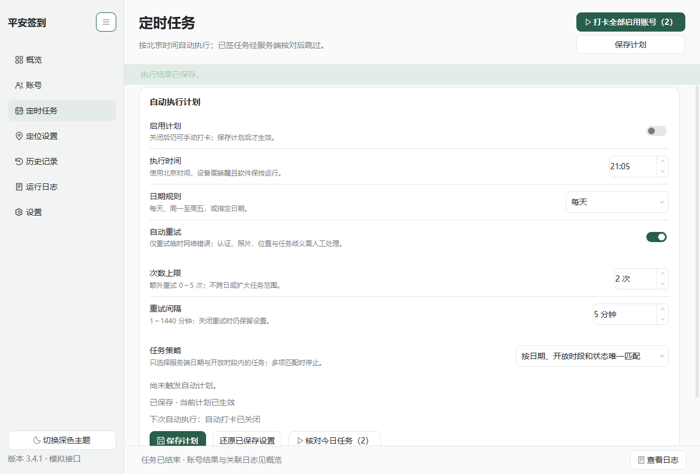

# 平安签到 · CSUFT Pingan Desktop

[](https://github.com/Yzcat766/csuft-pingan-desktop/releases/latest)
[](requirements.txt)
[](LICENSE)

一个面向中南林业科技大学平安签到场景的 Windows 桌面客户端。使用 Python + PySide6 构建，支持账号管理、定时执行、任务结果核对、历史查询和加密备份，提供深色与浅色界面。

**[下载 Windows 便携版](https://github.com/Yzcat766/csuft-pingan-desktop/releases/latest) · [从获取 OpenID 到首次签到](docs/OPENID_TO_CHECKIN.md) · [使用说明](docs/USAGE.md) · [开发与构建](docs/DEVELOPMENT.md) · [隐私说明](docs/PRIVACY.md)**



> 截图使用离线模拟账号。公开版本不包含任何个人账号或服务授权密钥；离线演示可直接使用，真实接口需要使用者自行配置合法取得的服务授权与自己的 OpenID。

## 功能

| 功能 | 说明 |
| --- | --- |
| 账号管理 | 多账号、启用/停用、范围选择、OpenID 导入预览与去重、只读账号检查 |
| 任务执行 | 手动执行、每日/工作日/指定日期计划、有限重试、执行中取消 |
| 状态核对 | 提交前后查询服务端状态，按任务和日期记录结果，区分失败与待核对 |
| 位置设置 | 账号级位置规则、位置管理、坐标校验与距离检查、可选偏移设置 |
| 历史与日志 | 独立历史存储、批次摘要、结构化日志、筛选与脱敏导出 |
| 数据保护 | Windows DPAPI 本地凭据保护、密码加密备份、恢复预览与回退 |
| 桌面体验 | 深浅主题、系统托盘、可选登录启动、任务期间防睡眠与失败通知 |

## 快速开始

第一次使用可先阅读 **[从获取 OpenID 到完成第一次签到](docs/OPENID_TO_CHECKIN.md)**：配合另一个开源项目 [python-openid-tool](https://github.com/Yzcat766/python-openid-tool)，按图文步骤获取自己的 OpenID、导入账号、配置服务授权与位置，核对首次执行结果后再启用定时。

### 直接使用 Windows 程序

1. 从 [Releases](https://github.com/Yzcat766/csuft-pingan-desktop/releases/latest) 下载 `CSUFT-Pingan-v3.4.1-windows-x64.zip`。
2. 解压到可写文件夹，双击 `CSUFT-Pingan.exe`。无需安装 Python。
3. 第一次使用建议先体验离线演示：在解压目录打开 PowerShell，执行 `./CSUFT-Pingan.exe --demo`。
4. 真实使用前按[使用说明](docs/USAGE.md)配置环境变量、添加自己的账号并核对位置、任务和时段。

程序默认使用程序旁的 `data/`，也支持 Windows 用户目录模式。更新前从托盘退出程序并备份，保留 `data/` 和 `data-mode.json`。

### 从源码运行

需要 **Windows x64、Python 3.12+**。建议使用 Python 3.13。

```powershell
git clone https://github.com/Yzcat766/csuft-pingan-desktop.git
cd csuft-pingan-desktop
python -m venv .venv
.venv/Scripts/python.exe -m pip install -r requirements.txt
.venv/Scripts/python.exe app.py --demo
```

也可双击 `install.cmd` 安装运行依赖，再双击 `start.cmd`。关闭演示后正常启动会使用独立的真实数据目录。

### 服务授权配置

公开发行版已移除源码中原有的固定服务授权头。正常联网前，在同一个 PowerShell 窗口设置授权并启动程序：

```powershell
$env:PINGAN_API_AUTHORIZATION = Read-Host '输入你合法取得的完整服务 Authorization 值'
./CSUFT-Pingan.exe
# 源码版改为：.venv/Scripts/python.exe app.py
```

账号的 OpenID 在程序内添加。未配置服务授权时，联网请求会在发送前停止并提示；离线演示和离线测试不需要真实凭据。`.env.example` 仅说明变量名称，程序不会自动加载 `.env` 文件。

## 界面预览

| 浅色概览 | 账号管理 |
| --- | --- |
|  |  |



## 验证与构建

```powershell
.venv/Scripts/python.exe -m pip install -r requirements-build.txt
.venv/Scripts/python.exe offline_tests.py
.venv/Scripts/python.exe build_exe.py
# 使用上一步输出的 EXE 完整路径：
.venv/Scripts/python.exe package_release.py --exe build/exe-日期-标识/dist/CSUFT-Pingan.exe
.venv/Scripts/python.exe verify_release.py
```

构建流程包含依赖检查、完整离线测试、源码演示启动、PyInstaller 打包、清理 Python/Conda PATH 后的 EXE 启动验证以及模块核验。发布包采用源码文件白名单，生成 SHA-256 校验清单。详细操作见[开发文档](docs/DEVELOPMENT.md)。

## 使用边界

这是独立开发的非官方客户端，与学校或平台不存在隶属关系。请仅用于自己的授权账号，遵守学校规则，如实填写位置与信息；服务端接口、OpenID 有效性或规则变化可能影响使用。

定时任务依赖软件运行且设备保持唤醒；关机或睡眠期间无法执行。离线测试验证模拟业务和桌面行为，不能证明真实账号或学校接口当前可用。

## 参与贡献与许可

欢迎提交可复现的问题和改进建议，提交前请阅读 [CONTRIBUTING.md](CONTRIBUTING.md)。反馈只需脱敏的错误信息与复现步骤。隐私与安全问题的处理方式见 [SECURITY.md](SECURITY.md)。

项目基于 [HeWhenJay/csuft-pingan-daka](https://github.com/HeWhenJay/csuft-pingan-daka) 的业务逻辑移植和扩展，沿用原有 [MIT 许可证](LICENSE)，并保留已有版权声明。第三方依赖及其许可证说明见 [THIRD_PARTY_NOTICES.md](THIRD_PARTY_NOTICES.md)。
