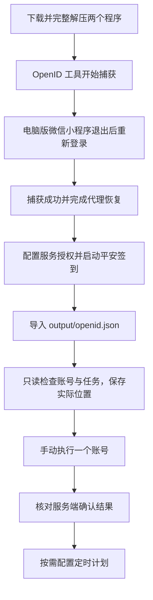

# 从获取 OpenID 到完成第一次签到

这篇教程把两个项目串起来：先用 **OpenID 工具**获取自己的 OpenID，再用 **平安签到桌面端**导入账号、核对配置并执行任务。适用于 Windows 10/11 x64 的便携版，无需安装 Python。

操作依据：OpenID 工具 **v1.0.0**、平安签到桌面端 **v3.4.1**。两个程序分别解压、分别运行，无需放在同一文件夹。

## 先分清两个程序和两项凭据

| 项目 | 做什么 | 下载 |
| --- | --- | --- |
| [python-openid-tool](https://github.com/Yzcat766/python-openid-tool) | 从本人正常登录小程序的响应中提取 OpenID，并保存 JSON/TXT | [OpenID 工具便携版](https://github.com/Yzcat766/python-openid-tool/releases/latest) |
| [csuft-pingan-desktop](https://github.com/Yzcat766/csuft-pingan-desktop) | 管理账号、查询任务、手动/定时执行、保存结果 | [平安签到便携版](https://github.com/Yzcat766/csuft-pingan-desktop/releases/latest) |

| 凭据 | 填在哪里 | 如何准备 |
| --- | --- | --- |
| 自己的 OpenID | 桌面端账号页，或通过结果文件导入 | 按下面的捕获步骤获取 |
| 服务授权头 `PINGAN_API_AUTHORIZATION` | 启动桌面端之前设置的环境变量 | 由使用者通过有权使用的服务渠道取得完整 Authorization 值 |

**当前公开版需要这两项。** OpenID 工具只导出 OpenID，不保存请求头，因此不会生成服务授权头。若你尚未取得合法可用的服务授权，请先向服务提供方或项目维护者确认接入方式；v3.4.1 不能仅凭 OpenID 完成联网签到。不要把 OpenID 填进 `PINGAN_API_AUTHORIZATION`。



## 1. 下载并完整解压

从两个项目的 Releases 页面下载带有 **windows-x64** 的 ZIP，解压到当前用户可写的本地文件夹。

| 程序 | 本教程对应的附件 | 解压后运行 |
| --- | --- | --- |
| OpenID 工具 v1.0.0 | `python-openid-tool-windows-x64.zip` | `OpenIDTool/OpenIDTool.exe` |
| 平安签到 v3.4.1 | `CSUFT-Pingan-v3.4.1-windows-x64.zip` | `CSUFT-Pingan.exe` |

OpenID 工具必须保留 EXE 同目录的 `_internal/` 和 `runtime/`，不要只拷贝一个 EXE。GitHub 自动生成的 `Source code (zip)` 是源码，不是上述 Windows 便携版。

## 2. 用 OpenID 工具获取自己的 OpenID

1. 打开电脑版微信并登录你自己的账号，再启动 `OpenIDTool.exe`。
2. 点击 **“开始捕获”**，等待界面明确显示 **“等待微信登录”**。默认等待时间为 120 秒。
3. 在电脑版微信中打开 **“中南林业科技大学学生工作部”** 小程序，进入 **“我的”**，退出后重新登录。
4. 等待工具显示捕获成功、结束清理。可点击 **“复制 OpenID”**，或点击 **“打开结果目录”**。


捕获会临时使用当前用户系统代理与工具根证书。正常结束、超时或取消后，工具会恢复原代理并清理本次新增的证书信任；请等它完成。若提示清理失败或上次异常退出，请在**原目录的同一份工具**中点击 **“恢复代理”**，恢复成功后再继续。不要删除 `.state/` 来跳过恢复。

成功后默认结果位于 **OpenIDTool.exe 所在目录**：

```text
OpenIDTool/
├─ OpenIDTool.exe
├─ _internal/
├─ runtime/
└─ output/
   ├─ openid.json    ← 推荐导入这个文件
   └─ openid.txt     ← 也可以导入
```

若改过输出目录，以“打开结果目录”实际打开的位置为准。下一次成功捕获会覆盖同名结果；处理多个自己的授权账号时，请每次捕获成功后先导入桌面端，再开始下一次。


## 3. 配置服务授权并启动平安签到（这一步可以跳过）

先从托盘真正退出已打开的平安签到程序。在 `CSUFT-Pingan.exe` 所在文件夹打开 PowerShell，执行：

```powershell
$env:PINGAN_API_AUTHORIZATION = Read-Host '输入你合法取得的完整服务 Authorization 值'
./CSUFT-Pingan.exe
```

按提示输入完整服务授权值，包括其授权方案前缀；输入后按回车。这里输入的是服务授权头，不是 OpenID、微信密码或短信验证码。

变量必须在启动程序**之前**设置。上面的设置仅对当前 PowerShell 及其启动的程序有效；已运行的实例不会更新。以后从另一个窗口、资源管理器或登录启动项运行时，不能假定它会继承这次临时设置。`.env.example` 只说明变量名称，程序不自动读取 `.env`。

只想先看界面时，可以运行 `./CSUFT-Pingan.exe --demo`；但演示数据不会写入真实账号列表，不能用演示模式完成下面的真实任务。

## 4. 把捕获结果导入账号页

1. 在平安签到左侧选择 **“账号”**。
2. 点击 **“导入 OpenID 工具结果”**，选择上一步生成的 `output/openid.json`。
3. 在 **“导入预览”** 中核对解析数量和去重后新增数量，再确认。重复导入同一个 OpenID 不会新增重复账号。
4. 新账号通常名为“导入账号 1”等，可以点击该行 **“编辑”**，改成自己容易辨认的名称并 **“保存账号”**。

也可使用 `openid.txt`，或在添加账号弹窗中粘贴通过“复制 OpenID”取得的值。不要选择 `.state/restore.json`、CA 文件或整个输出文件夹。


JSON 文件可以直接导入，不用删掉其中的 `endpoint`、`captured_at` 等字段；桌面端只读取字符串 `openid`。下面仅为文件结构示例，`demo-openid-only` 不能用于真实登录：

```json
{
  "openid": "demo-openid-only",
  "endpoint": "https://example.invalid/api/getOpenid",
  "captured_at": "2026-10-29T00:00:00+00:00"
}
```

## 5. 检查账号、任务和位置

先选中刚导入的账号，点击 **“检查账号（只读）”**，核对身份、任务名称、日期、开放时段和配置提示。这一步会联网登录和查询，**不会提交签到**。未选中账号时会检查全部账号。

再打开 **“定位设置”**，保存与你实际所在地点一致的位置，选择全局规则后点击 **“保存全局定位”**；如需账号单独设置，在账号编辑弹窗中选择相应位置并保存。

程序**不会读取设备 GPS**。初始的校园公共坐标只是预置位置，不代表你的实际位置或任务允许范围；不能直接据此判断配置正确。核对账号行显示的“有效定位配置”，首次使用保留位置偏移关闭。服务端要求照片、距离不满足或任务有歧义时，按提示处理或使用官方入口。

如果“检查账号”提示未配置服务授权，回到第 3 步；提示 OpenID 无效时，核对捕获时登录的是自己的正确账号，必要时重新捕获并更新账号。

## 6. 手动完成一个账号的任务并核对结果

1. 确认当前在任务开放时段内，账号、任务日期与实际位置均正确。
2. 在账号页点击该账号行内的 **“打卡”**，首次先验证一个账号。顶部 **“打卡全部启用账号”** 会执行所有启用账号，搜索筛选不会缩小这个范围。
3. 如出现批次确认或定位预览，核对本次范围与位置后继续；等待本次任务结束。
4. 在 **“概览”** 查看批次摘要，在 **“历史记录”** 核对账号、任务、日期和最终结果；需要时打开 **“运行日志”** 查看原因。

成功应以程序查询到的**服务端确认结果**为准。“导入成功”“账号可登录”或“请求已发出”都不等同于签到成功。结果显示“待核对”或网络异常时，先查看日志或在官方入口核对状态，再决定是否重试。


## 7. 手动验证成功后，再按需启用定时

进入 **“定时任务”**，选择每日、工作日或指定日期，设置任务开放时段内的北京时间，核对参与账号，启用计划并点击 **“保存计划”**。首次可保留默认有限重试规则。


设备需要保持唤醒，程序需要运行或留在托盘。关机、睡眠或真正退出后不会执行，程序也没有注册 Windows 唤醒任务。

如果以后希望登录 Windows 后自动运行，请同时核对启动方式能否取得服务授权环境变量；第 3 步的临时变量不会自动持久保存。不要把完整授权值写进公开脚本或 GitHub。自动计划启用后，第二天应主动查看执行结果；某项任务成功不代表其他任务也已完成。

## 常见卡点

| 卡在哪里 | 下一步 |
| --- | --- |
| OpenID 工具超时 | 先等“等待微信登录”再退出小程序重新登录；如电脑版微信忽略代理或接口变化，可能无法捕获，查看工具自己的排错说明 |
| 提示遗留恢复记录或网络异常 | 用原目录工具“恢复代理”，恢复成功后继续；不要删除恢复记录 |
| 找不到 `openid.json` | 点击“打开结果目录”；默认在 OpenIDTool.exe 旁的 `output/`，不是签到程序目录 |
| 导入预览新增为 0 | 同一 OpenID 已存在时属于正常去重；到已有账号行查看或编辑 |
| 导入成功但提示未配置服务授权头 | OpenID 与 Authorization 是两项配置，按第 3 步设置后完全重启程序 |
| 登录成功但没有当前可执行任务 | 核对日期、任务开放时间和账号；存在多个任务时按界面配置精确任务名称 |
| 距离不符或要求照片 | 核对真实位置并按任务要求操作，需要时使用官方入口 |
| 到时间没有执行 | 检查计划是否保存、程序是否运行、设备是否唤醒，以及该启动方式是否有授权环境变量 |

请保管好 OpenID 文件、服务授权、账号数据与备份。反馈问题时只提供脱敏错误与复现步骤，不要上传原始 `output/`、`data/`、`.state/` 或个人账号截图。

更多说明：[桌面端使用说明](USAGE.md) · [OpenID 工具完整说明](https://github.com/Yzcat766/python-openid-tool#readme) · [隐私说明](PRIVACY.md)。
